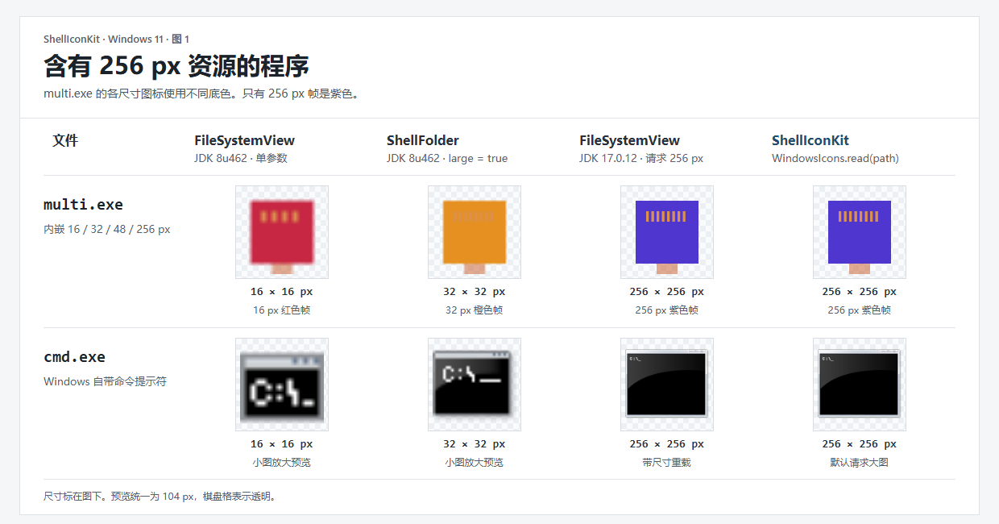
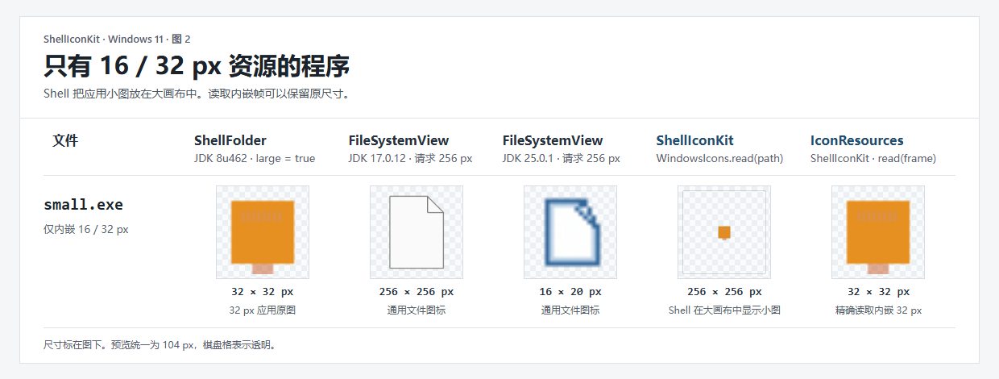

# Windows 图标读取对比

## 有 256 px 资源

`multi.exe` 的 256 px 图标是紫色。JDK 8 的 `FileSystemView` 取到 16 px 红图，`ShellFolder.getIcon(true)` 取到 32 px 橙图。JDK 17 的尺寸重载和 ShellIconKit 都取到了紫图。

这是 [JDK 8 的实现](https://github.com/openjdk/jdk8u/blob/master/jdk/src/windows/classes/sun/awt/shell/Win32ShellFolder2.java) 的限制，不是 JavaFX 转图引起的。如果只在 JDK 17+ 的 Swing 界面里显示，先用公开的 [`FileSystemView.getSystemIcon(file, width, height)`](https://docs.oracle.com/en/java/javase/17/docs/api/java.desktop/javax/swing/filechooser/FileSystemView.html#getSystemIcon(java.io.File,int,int))。

## 只有 16 / 32 px 资源

在 `small.exe` 上，JDK 17.0.12 和 25.0.1 请求 256 px 都返回了通用文件图标。Shell 保留应用图案，但把小图放在 256 px 画布中。`IconResources.read(frame)` 可直接读出内嵌的 32 px 帧。

